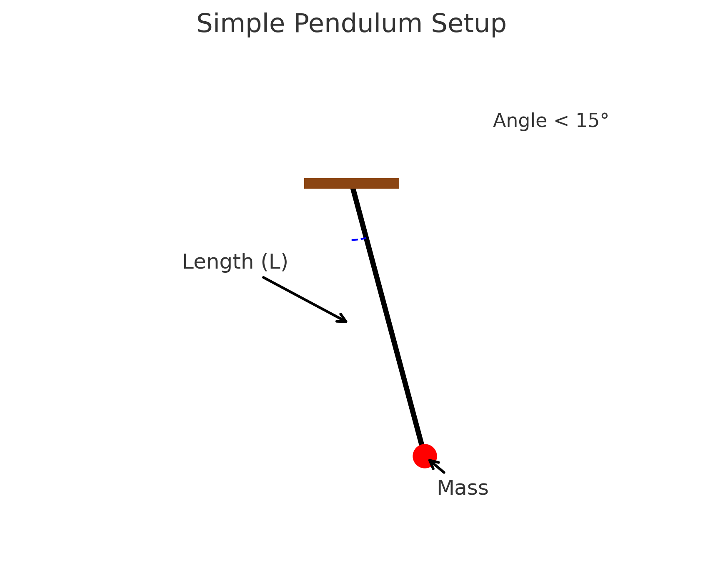
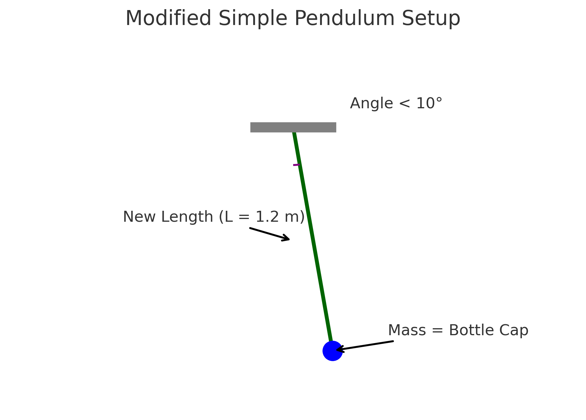

## Measuring Earth's Gravitational Acceleration with a Pendulum

A simple pendulum can be used to measure Earth's gravitational acceleration (`g`) by analyzing its periodic motion. The time it takes for the pendulum to complete one full swing (its period) depends on the length of the pendulum and the value of `g`. Using the formula:

T = 2π√(L/g)

where:

- `T` is the period (time for one complete oscillation),
- `L` is the length of the pendulum,
- `g` is the gravitational acceleration,

we can rearrange the formula to solve for `g`:

g = 4π²L / T²

By accurately measuring the length of the pendulum and the time for multiple oscillations, we can calculate an experimental value for gravitational acceleration.

## 

# 🧪 Measuring Earth's Gravitational Acceleration Using a Pendulum

This experiment uses a simple pendulum to estimate the gravitational acceleration \( g \) on Earth. It emphasizes careful measurement, uncertainty analysis, and comparison with the accepted value \( g = 9.81 \, \text{m/s}^2 \).

---

## 🛠️ Materials

- String (1–1.5 meters)
- Small mass (e.g., keys, coins, bag of sugar)
- Stopwatch or smartphone
- Ruler or measuring tape

---

## 🔧 Procedure Summary

1. **Construct the Pendulum**  
   Attach a weight to the string and suspend it from a fixed support.

2. **Measure the Length**  
   Measure the length \( L \) from the suspension point to the center of the mass. Record the uncertainty \( \Delta L = \frac{\text{ruler resolution}}{2} \).

3. **Time the Oscillations**  
   Displace the pendulum < 15°, release it, and measure the time for 10 full oscillations. Repeat this 10 times.

4. **Calculate the Period**  
   \(
   T = \frac{T*{10}}{10}, \quad \Delta T = \frac{\Delta T*{10}}{10}
   \)

---

## 🧮 Calculations

1. **Estimate Gravitational Acceleration**
   $$
      \
      g = \frac{4\pi^2 L}{T^2}
      \
   $$
2. **Propagate Uncertainty**

   $$
      \
      \Delta g = g \sqrt{\left(\frac{\Delta L}{L}\right)^2 + \left(2 \frac{\Delta T}{T}\right)^2}
      \
   $$

3. **Compare with Standard Value**  
   Experimental \( g \) is compared with the known standard \( 9.81 \, \text{m/s}^2 \).

---

## 🔍 Analysis Prompts

- How close is your measured \( g \) to 9.81 m/s²?
- Discuss the effect of ruler resolution on \( \Delta L \).
- Discuss variability in timing and its impact on \( \Delta T \).
- Reflect on assumptions (e.g., small-angle approximation, negligible air resistance).

---

## 
